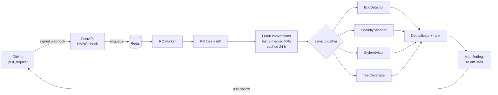

# CodeSage

**A GitHub App that reviews pull requests with four concurrent agents (bugs, security, style, tests) and posts inline comments on the exact changed lines.**

[](https://github.com/rakshithmuda22/codesage/actions/workflows/ci.yml)
[](https://www.python.org/downloads/release/python-3110/)
[](https://fastapi.tiangolo.com)
[](https://console.groq.com)
[](https://redis.io)
[](LICENSE)

## The problem

LLM review bots tend to fail in two boring ways. Their comments land on the wrong line, or GitHub rejects the whole review because a comment points outside the diff. And their style advice is textbook rules, not what *your* repo actually does.

CodeSage is built around those two problems:

- **Comments are placed by parsing the PR diff**, and only lines GitHub will accept are posted inline. Everything else goes in the review summary rather than being moved to a "nearby" line.
- **StyleAdvisor checks code against conventions learned from the repo's last three merged PRs** instead of generic rules.

## What it does

1. GitHub sends a `pull_request` webhook (`opened` / `synchronize`). FastAPI verifies the HMAC signature and enqueues a job in Redis (RQ). The request returns immediately.
2. An RQ worker fetches the PR's files and diff through the GitHub App API, builds an import dependency graph (each changed file is scored by how many other changed files depend on it), and loads the repo's conventions (learned from the last 3 merged PRs, cached in Redis for 24 h).
3. Four agents run concurrently with `asyncio.gather()`; one agent failing does not stop the others:
   - **BugDetector**: null dereferences, off-by-one, resource leaks and similar (LLM).
   - **SecurityScanner**: regex pass for secrets, `eval`, `shell=True`, weak hashes, `innerHTML` and similar, plus an LLM pass on security-sensitive files.
   - **StyleAdvisor**: deviations from the learned conventions (LLM, severity capped at MEDIUM).
   - **TestCoverage**: finds the matching test file in the PR and flags functions with no test (LLM, with a non-LLM fallback).
4. Findings are de-duplicated (findings on the same file within 3 lines that look alike are merged, highest severity wins), mapped onto the diff, and posted as one review.

Python, JavaScript and TypeScript sources are reviewed; functions are extracted with tree-sitter.

## Example

This is real output from the offline demo below. The "LLM" in that demo is a scripted stand-in (`devtools/fake_services.py`), so it shows the plumbing (webhook, queue, concurrency, line mapping), not model quality.

```text
$ python devtools/send_webhook.py
POST http://localhost:8000/webhook/github  signature=sha256=213221468ab7c7ef1...
-> 200 {"status":"queued","job_id":"adc7a3d2-79d8-47f8-8d97-ab78a6f195c7","rq_job_id":"ee93d342-..."}
job adc7a3d2: queued  (+0.0s)
job adc7a3d2: started  (+0.5s)
job adc7a3d2: finished  (+1.1s)
decision=REQUEST_CHANGES findings=10 (critical=2 high=3 medium=3 low=2) files=2 pipeline=0.2s

Review posted to PR #42 (event=COMMENT, 9 inline comments)
  lib/auth.py:4   CRITICAL: Hardcoded secret detected
      on: API_KEY = "sk-live-9f8e7d6c5b4a3210"
  lib/auth.py:20  CRITICAL: SQL injection through f-string query
      on: query = f"SELECT * FROM users WHERE name = '{username}'"
  web/cart.js:5   HIGH: Loop runs one past the end of items
      on: for (let i = 0; i <= items.length; i++) {
  ...
Not attachable inline (line outside every hunk), listed in the summary instead:
  lib/auth.py:13
```

The SQL injection comment is one finding merged from two agents:

> **🚨 CRITICAL: SQL injection through f-string query**
>
> **BugDetector**: A username containing a quote breaks the query.
>
> **SecurityScanner**: username is interpolated into the SQL string; ' OR '1'='1 returns every row.
>
> **Suggestion:** Pass the value as a bound parameter. | Use a parameterised query: db.execute(sql, (username,)).
>
> *Detected by CodeSage BugDetector, SecurityScanner*

## Quickstart

### Try it with no accounts (Docker)

Runs real Redis, API and RQ worker containers against a fake GitHub API and a scripted stand-in for Groq. Nothing is written to GitHub and no API key is needed.

```bash
git clone https://github.com/rakshithmuda22/codesage.git && cd codesage
docker compose -f docker-compose.demo.yml up --build -d
docker compose -f docker-compose.demo.yml exec app python devtools/send_webhook.py --fake-url http://fake:9000
docker compose -f docker-compose.demo.yml logs worker      # JSON log line per pipeline step
docker compose -f docker-compose.demo.yml down -v
```

`send_webhook.py --unsigned` and `--bad-signature` send requests the server must reject with `401`.

### Run the agents on their own (no Docker, no Redis)

```bash
python3.11 -m venv .venv && source .venv/bin/activate
pip install -r requirements.txt
python demo_review.py                                  # bundled sample PR, scripted LLM
CODESAGE_TARGET_REPO=path/to/dir python demo_review.py # any local dir; only the regex scanner can find things
pytest
```

### Use it on a real repository

1. Create a [GitHub App](https://github.com/settings/apps): webhook URL `https://<your-host>/webhook/github`, a webhook secret, permissions *Pull requests: read & write* and *Contents: read*, event *Pull request*. Generate a private key and save it as `./private-key.pem`. Install the app on a repo.
2. Get a [Groq API key](https://console.groq.com).
3. `cp .env.example .env` and fill in `GITHUB_APP_ID`, `GITHUB_WEBHOOK_SECRET`, `GROQ_API_KEY`.
4. `docker compose up --build` (API on `:8000`, worker, Redis). For local development expose the port with a tunnel such as ngrok.

CodeSage uses a **GitHub App** (JWT signed with the private key, exchanged for an installation token), not an OAuth App or a personal token. A `401` from GitHub usually means the wrong App ID or key.

To exercise the signature check by hand:

```bash
SECRET="demo-webhook-secret"   # must equal GITHUB_WEBHOOK_SECRET
PAYLOAD='{"action":"opened","pull_request":{"number":42,"title":"Test PR","head":{"sha":"abc123"},"base":{"sha":"def456"}},"repository":{"full_name":"acme/shop"},"installation":{"id":12345}}'
SIG=$(printf '%s' "$PAYLOAD" | openssl dgst -sha256 -hmac "$SECRET" | awk '{print $NF}')
curl -X POST http://localhost:8000/webhook/github \
  -H "Content-Type: application/json" -H "X-GitHub-Event: pull_request" \
  -H "X-Hub-Signature-256: sha256=$SIG" -d "$PAYLOAD"
```

### Configuration

| Variable | Purpose |
|---|---|
| `GITHUB_APP_ID`, `GITHUB_PRIVATE_KEY_PATH` | GitHub App credentials |
| `GITHUB_WEBHOOK_SECRET` | Required. If unset the webhook answers `503`; a missing or wrong signature gets `401` |
| `GROQ_API_KEY`, `GROQ_MODEL` | Groq key and model (default `llama-3.1-8b-instant`) |
| `REDIS_URL` | Redis for the queue and the convention cache |
| `CODESAGE_POST_VERDICTS` | `true` to post `APPROVE` / `REQUEST_CHANGES`. Default: every review is a plain `COMMENT`, so the bot never approves or blocks a merge |
| `GITHUB_API_URL`, `GROQ_BASE_URL` | Point at GitHub Enterprise, or at the fakes used by the demo |
| `LOG_LEVEL`, `PORT` | Logging level, API port |

## How it works



### Getting comments onto the right line

GitHub only accepts an inline review comment on a line that is part of the PR diff. `core/github_client.py` handles this in four steps:

1. `DiffParser` reads the unified diff hunk by hunk (using the line counts in each `@@` header, so a removed `-- sql comment` is not mistaken for a file header) and records every new-file line that appears in the diff, along with its diff position.
2. The prompts carry absolute line numbers (`  12 | code`) and large files are split in chunks that keep their offsets, so the line numbers the model returns are file line numbers.
3. A finding whose line is in the diff is posted with `line` + `side=RIGHT`. Any other finding is listed in the review summary instead of being snapped to a nearby line.
4. If GitHub still answers `422` (for example the PR head moved), the review is re-posted once with every finding in the summary.

An earlier version of this parser keyed files by the text after the first `b/` (so `lib/auth.py` became `auth.py b/lib/auth.py`) and counted `index` / `---` / `+++` lines as diff positions, so inline comments were silently dropped or misplaced. The tests below pin the fixed behaviour.

### Concurrency and rate limits

All four agents run under one `asyncio.gather(..., return_exceptions=True)`, and each agent analyses its files concurrently. `LLMClient` allows 5 calls in flight and 30 calls per minute (a sliding window, configured for Groq's free tier), retries with backoff (up to 3 attempts), re-asking for strict JSON after a malformed reply. RQ jobs are enqueued with `Retry(max=2, interval=[30, 120])`.

## Tests and CI

```text
$ pytest
126 passed
```

(`tests/test_worker.py::test_job_goes_through_redis_and_an_rq_worker` needs a Redis on `REDIS_URL` and is skipped without one.)

| Area | Tests | What is checked |
|---|---|---|
| `test_diff_parser.py` | 39 | Hand-computed positions; paths containing `b/`; `--`/`++` content lines; renames, deletes, binary files, "No newline" markers; 25 randomized runs against real `git diff` output that verify every mapped line points at the same text in the new file |
| `test_github_review.py` | 6 | JSON sent to GitHub (line/side), out-of-diff findings go to the summary, 422 fallback, body size cap |
| `test_webhook.py` | 21 | Fails closed: no secret, no/wrong/tampered/non-ASCII signature, legacy sha1 header. Event routing, queue outage |
| `test_worker.py` | 7 | Pipeline with fake GitHub/LLM, four agents start before any finishes, one failing agent does not block the rest, Redis -> RQ worker -> result, COMMENT-only default |
| `test_agents.py`, `test_deduplicator.py`, `test_dependency_graph.py` | 39 | Agents with a mock LLM, merge/rank logic, import graph |
| `test_convention_learner.py`, `test_parsing.py`, `test_logging.py` | 14 | Convention learning (3 PRs, JS repos, bad LLM output), tree-sitter function names for Python/JS/TS, numbered prompts and chunk offsets, flat JSON logs |

CI (`.github/workflows/ci.yml`) runs four jobs: `pytest` with a Redis service, `flake8`, a Docker build, and an end-to-end job that starts `docker-compose.demo.yml`, sends a signed webhook, requires the review to be posted, and requires an unsigned webhook to be rejected.

## Limitations

- **Review quality is not measured.** The tests and the demo use mocked or scripted LLM replies; there is no labelled PR set and no precision/recall number yet. Real runs depend on `llama-3.1-8b-instant` through Groq.
- **Tested against fakes, not against live GitHub.** The GitHub client is exercised with an HTTP mock and with `devtools/fake_services.py`, which rejects comments outside the diff the way GitHub does. The GitHub App flow itself needs your own app to try.
- Agents read whole files (first 6-8k characters per file or chunk), so they can flag code the PR did not touch. Those findings appear in the summary, not inline.
- Convention learning measures naming, type hints and docstrings only for Python (via `ast`); for JS/TS repos it relies on a single LLM call over the added code.
- A `synchronize` event posts a fresh review; earlier comments are not resolved or de-duplicated.
- `/`, `/jobs` and `/jobs/{id}` are unauthenticated and the job list is in memory. Do not expose them for private repos.
- Python, JavaScript and TypeScript only.

## Project layout

```text
main.py                  FastAPI app: webhook, /jobs, /health, dashboard
core/worker.py           RQ enqueue + the review pipeline
core/github_client.py    GitHub App auth, DiffParser, review posting
core/llm_client.py       Groq client: rate limit, retry, JSON parsing
core/convention_learner.py, deduplicator.py, dependency_graph.py, repo_analyzer.py
agents/                  BugDetector, SecurityScanner, StyleAdvisor, TestCoverage
prompts/                 prompt templates
devtools/                fake GitHub + Groq APIs, signed-webhook sender (demo and CI only)
docker-compose.yml       API + worker + Redis
docker-compose.demo.yml  same stack against the fakes, no accounts needed
docs/adr/                design decisions: tree-sitter, parallel agents, Redis queue
```

## License

MIT
